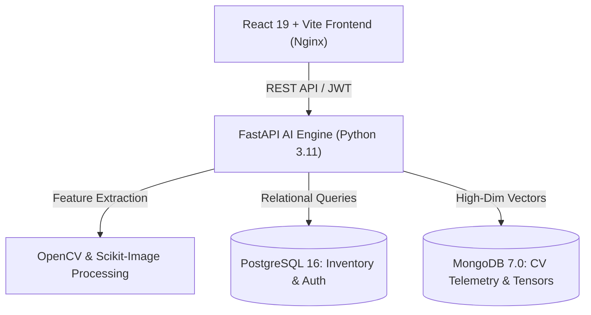

# 🥑 FreshGuard — AI Food Freshness & Quality Intelligence Platform

[](https://aws.amazon.com/)
[](https://www.docker.com/)
[](https://fastapi.tiangolo.com/)
[](https://reactjs.org/)
[](https://www.postgresql.org/)
[](https://www.mongodb.com/)

**FreshGuard** is an end-to-end, enterprise-grade AI computer vision and inventory management system engineered to automate food freshness assessment, estimate shelf life, predict spoilage, and streamline grocery & cold-storage supply chains.

---

## 🌟 Key Features

### 👁️ 1. Computer Vision & Food Image Analysis Engine
- **Autonomous Foreground Segmentation**: Otsu thresholding, saturation filtering, and morphological opening/closing isolating food items from background noise.
- **Color Degradation & Browning Index (BI)**: Transforms images to CIE $L^*a^*b^*$ and HSV color spaces to compute the standard Browning Index:
  $$x = \frac{a^* + 1.75 L^*}{5.645 L^* + a^* - 3.012 b^*}, \quad \text{BI} = \frac{100(x - 0.31)}{0.172}$$
- **Texture Analysis & Shrivel Index**: Laplacian variance, gray-level spatial entropy, and gradient roughness metrics evaluating moisture loss and skin wrinkling.
- **Multi-Class Defect Detection**:
  - **Mold & Mycelium Spores**: Spatial frequency & entropy filtration.
  - **Subsurface Bruising**: Localized differential reflectance in $a^*/b^*$ channels.
  - **Physical Damage**: Edge discontinuity analysis detecting punctures, cuts, and tears.
- **5-Tier Freshness Grading**:
  - `Fresh` (85–100%) | `Good` (70–84%) | `Acceptable` (50–69%) | `Near Spoilage` (30–49%) | `Spoiled` (0–29%)
  - **Quality Grades**: Grade A (Premium) through Grade F (Reject).
- **Interactive Visual Diagnostics**: Returns bounding boxes and color-coded diagnostic masks directly on analyzed items.

### 📦 2. Smart Inventory & Shelf-Life Predictor
- Real-time stock status monitoring, batch-level tracking, and expiration countdowns.
- Dynamic shelf-life prediction factoring in storage temperatures (Cold Storage $2\text{--}4^\circ\text{C}$ vs. Ambient $20\text{--}25^\circ\text{C}$).
- FIFO (First-In, First-Out) dispatch recommendations to minimize inventory waste.

### 💬 3. AI Recipe & Utilization Chatbot
- Context-aware chatbot recommending recipes, preservation tips, and discount markdown suggestions for near-expiration inventory.

### 📊 4. Analytics, Auditing & Exporting
- Real-time degradation curves, compliance reports, and instant PDF audit generation for quality assurance and regulatory inspections.

---

## 🏗️ Architecture



---

## 🛠️ Tech Stack

| Layer | Technologies |
| :--- | :--- |
| **Frontend** | React 19, Vite, Lucide Icons, Chart.js, HTML5 Canvas, Vanilla Modern CSS |
| **Backend** | FastAPI, Uvicorn, Python 3.11, Pydantic v2, PyJWT, Passlib |
| **Computer Vision** | OpenCV (`cv2`), NumPy, Scikit-Image, PIL |
| **Databases** | PostgreSQL 16 (Relational/Inventory) & MongoDB 7.0 (Telemetry) |
| **DevOps & Cloud** | Docker, Docker Compose, AWS EC2, AWS App Runner / ECS, AWS Amplify |

---

## 🚀 Quickstart (Local Development)

### Prerequisites
- [Docker & Docker Compose](https://www.docker.com/) installed **OR** Python 3.11+ and Node.js 18+

### Method 1: 1-Click with Docker Compose (Recommended)
```bash
# Clone the repository
git clone https://github.com/K-Rahul-Satyam/food-freshness.git
cd food-freshness

# Spin up all services (PostgreSQL, MongoDB, Backend, Frontend)
docker compose up --build
```
- **Frontend**: http://localhost
- **Backend API & Swagger Docs**: http://localhost:8000/docs

---

### Method 2: Running Without Docker

#### 1. Backend Setup
```bash
cd backend
python -m venv venv
venv\Scripts\activate   # Windows (or: source venv/bin/activate on Linux/Mac)
pip install -r requirements.txt
python main.py
```
*API runs on `http://127.0.0.1:8000`*

#### 2. Frontend Setup
```bash
cd frontend
npm install
npm run dev
```
*Web client runs on `http://localhost:5173`*

---

## ☁️ AWS Cloud Deployment

This project is configured for deployment on **Amazon Web Services (AWS)**:

- **EC2 + Docker Compose**: Launch an Ubuntu EC2 instance, clone the repository, and run `docker compose up -d`.
- **Managed Containers**: Deploy container images via **Amazon ECR** to **AWS App Runner** or **ECS Fargate**.
- **Static Hosting**: Deploy frontend to **AWS Amplify** or **Amazon S3 + CloudFront**.

---

## 🛡️ Default Demo Credentials

| Role | Username | Password |
| :--- | :--- | :--- |
| **Admin** | `admin` | `admin123` |
| **Auditor / User** | `demouser` | `password123` |

---

## 📄 License
This project is licensed under the [MIT License](LICENSE).
